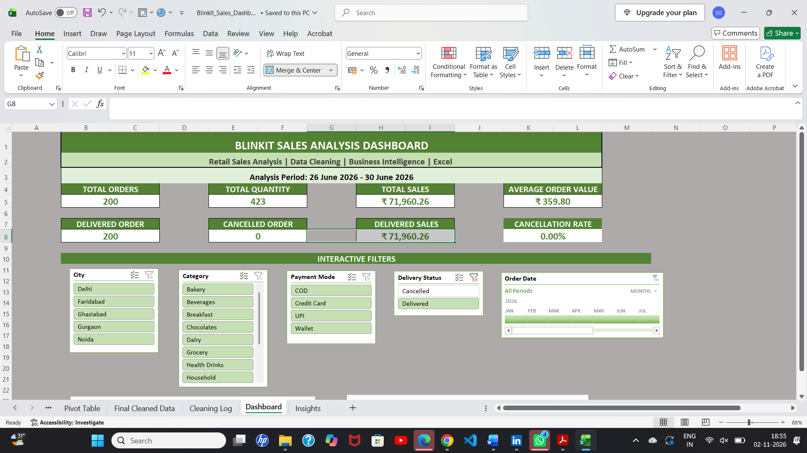
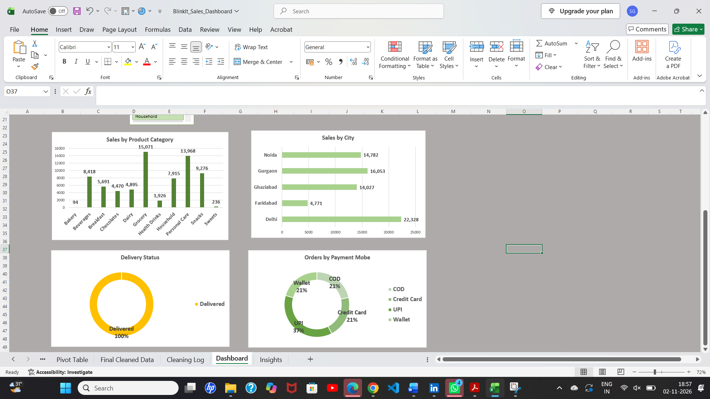

# Blinkit Sales Analysis Dashboard using Excel

## Project Overview

This project focuses on analysing retail sales data using Microsoft Excel. The goal is to clean and transform the data, calculate important business KPIs, and create an interactive dashboard to understand sales performance.

The dashboard allows users to explore sales using filters such as City, Product Category, Payment Mode, Delivery Status, and Order Date.

## Dashboard Preview

## Tools and Technologies

- Microsoft Excel
- Power Query
- PivotTables
- PivotCharts
- Excel Slicers and Timeline
- Data Cleaning and Transformation

## Dataset Overview

- Total records: 210 orders
- Analysis period: 26 June 2026 to 30 June 2026
- Cities: Delhi, Faridabad, Ghaziabad, Gurgaon, and Noida
- Product categories: Grocery, Personal Care, Beverages, Snacks, and others
- Payment modes: COD, Credit Card, UPI, and Wallet

## Key Performance Indicators (KPIs)

| KPI | Value |
|---|---:|
| Total Orders | 210 |
| Total Quantity | 445 |
| Total Sales | ₹76,230.38 |
| Average Order Value | ₹363.00 |
| Delivered Orders | 200 |
| Cancelled Orders | 10 |
| Delivered Sales | ₹71,960.26 |
| Cancellation Rate | 4.76% |

## Dashboard Features

- Interactive KPI cards
- Sales analysis by product category
- City-wise sales analysis
- Delivery status analysis
- Orders by payment method
- Interactive slicers for City, Category, Payment Mode, and Delivery Status
- Order Date Timeline for date-based filtering

## Key Business Insights

- Grocery generated the highest sales among the product categories.
- Delhi recorded the highest sales among the five cities.
- UPI had the highest number of orders among the payment methods.
- Out of 210 orders, 200 were delivered and 10 were cancelled.
- The overall cancellation rate was approximately 4.76%.

## Learning Outcomes

Through this project, I practised:

- Cleaning and transforming raw data.
- Using Power Query for data preparation.
- Creating PivotTables for business analysis.
- Building PivotCharts to present data visually.
- Creating interactive dashboards using Slicers and Timelines.
- Calculating KPIs and interpreting business insights.

## Project Limitations

- The dataset contains 210 orders over a five-day period.
- The findings represent only this dataset and should not be treated as the overall performance of Blinkit.
- A larger dataset covering a longer period would be required for broader business conclusions.

## Project Files

- `BlinkIt_Sales_Dashboard.xlsx` - Excel workbook containing the data, analysis, PivotTables, and dashboard.
- `dashboard-1.png` and `dashboard-2.png` - Dashboard screenshots.

## Author

**Shivani Girase**

B.E. Computer Engineering Student

GitHub: [shivanigirase](https://github.com/shivanigirase)

LinkedIn: [Shivani Girase](https://www.linkedin.com/in/shivani-girase-224b45353/)
